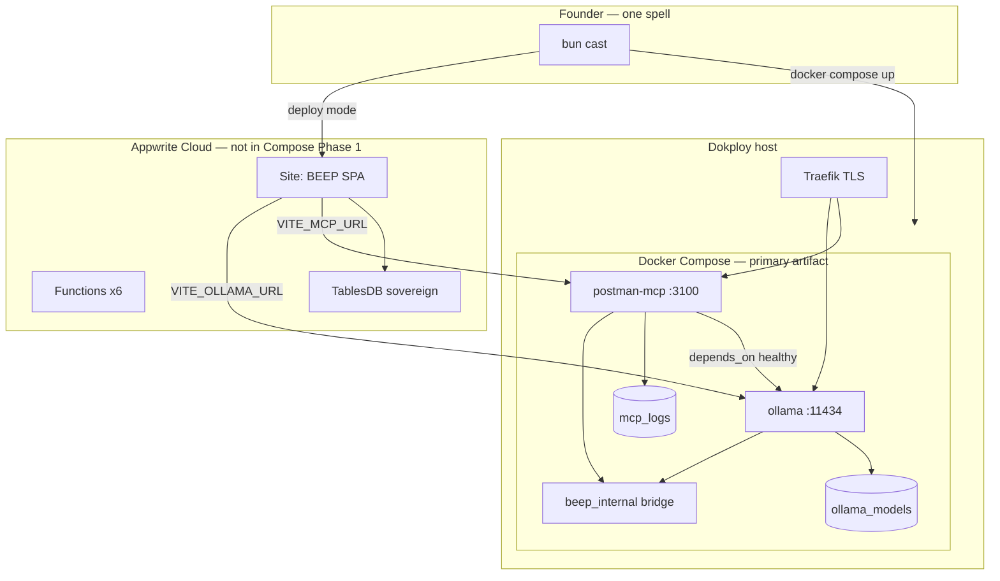

# BEEP Production Docker Compose

**Primary deliverable:** a production-grade [`docker-compose.yml`](file:///home/titan/projects/beep/docker-compose.yml) for BEEP backends, deployable on Dokploy, with multi-stage Dockerfiles, isolated networks, persistent volumes, health checks, and correct service ordering.

**Founder UX:** you never touch Compose flags. You cast one spell — `bun cast` — which runs Compose for you with live terminal output. The stack is Docker; the invocation is ΛΞV.

---

## ΛΞV — the spell and the stack

ΛΞV is not branding pasted on DevOps. It is the architecture:

| Symbol | Meaning in this plan |
|--------|----------------------|
| **Λ (Lambda)** | The function — `bun cast`, one transform from intent → running system |
| **Ξ (Xi)** | The unknown — Ollama inference, agent workflows, emergent behavior |
| **V (Von Neumann)** | The machine — Docker Compose, deterministic containers, stored state in volumes |
| **& Co.** | The firm — you, the founder; one command, full visibility |

When you run `bun cast`, you are casting the same spell the name encodes: **function → unknown → machine**, operated by human intent.

Terminal banner (digital wabi-sabi glass temple aesthetic — monospace, soft cyan/amber ANSI, no clutter):

```
  ╭─ ΛΞV & Co. ─ BEEP Dominion ─ CAST ─────────────────╮
  │  LAM-duh · ZAI · VAWN  —  Function · Unknown · Machine │
  ╰──────────────────────────────────────────────────────╯
  ▶ docker compose up  ·  sovereign backends awakening…
```

---

## Architecture



**Phase 1 rule:** Compose owns **long-running compute** (Ollama, MCP). Appwrite Cloud owns **ledger + UI hosting** (Sites, Functions, TablesDB). Appwrite is **not** duplicated inside Compose — data persistence for BaaS lives in Appwrite Cloud; Compose volumes hold models and logs only.

**Phase 2 (optional profile):** `docker-compose.sovereign.yml` — self-hosted Appwrite per [`EVOLUTION.md`](file:///home/titan/projects/beep/EVOLUTION.md) Island Mode. Deferred unless required.

---

## `docker-compose.yml` (full spec)

Path: [`beep/docker-compose.yml`](file:///home/titan/projects/beep/docker-compose.yml)

```yaml
name: beep-dominion

networks:
  beep_internal:
    driver: bridge
    name: beep_internal

services:
  ollama:
    image: ollama/ollama:latest
    container_name: beep-ollama
    restart: unless-stopped
    networks: [beep_internal]
    volumes:
      - ollama_models:/root/.ollama
      - ./docker/ollama/entrypoint.sh:/entrypoint.sh:ro
      - ./assets/modelfiles:/modelfiles:ro
    environment:
      OLLAMA_HOST: 0.0.0.0:11434
      OLLAMA_ORIGINS: ${OLLAMA_ORIGINS:-*}
    entrypoint: ["/bin/sh", "/entrypoint.sh"]
    healthcheck:
      test: ["CMD", "curl", "-f", "http://localhost:11434/api/tags"]
      interval: 15s
      timeout: 5s
      retries: 10
      start_period: 120s
    deploy:
      resources:
        limits:
          cpus: "4.0"
          memory: 8G
        reservations:
          memory: 2G
    logging:
      driver: json-file
      options:
        max-size: "50m"
        max-file: "5"

  postman-mcp:
    build:
      context: .
      dockerfile: Dockerfile.mcp
    image: ${BEEP_MCP_IMAGE:-beep-mcp:local}
    container_name: beep-postman-mcp
    restart: unless-stopped
    networks: [beep_internal]
    depends_on:
      ollama:
        condition: service_healthy
    environment:
      MCP_SERVER_PORT: "3100"
      MCP_SERVER_HOST: 0.0.0.0
      MCP_ALLOWED_HOSTS: ${MCP_ALLOWED_HOSTS:-*}
      POSTMAN_API_KEY: ${POSTMAN_API_KEY:-}
      POSTMAN_API_BASE_URL: ${POSTMAN_API_BASE_URL:-https://api.getpostman.com}
      NODE_ENV: production
    volumes:
      - mcp_logs:/app/logs
    healthcheck:
      test: ["CMD", "curl", "-f", "http://localhost:3100/health"]
      interval: 10s
      timeout: 5s
      retries: 6
      start_period: 15s
    deploy:
      resources:
        limits:
          cpus: "1.0"
          memory: 512M
    logging:
      driver: json-file
      options:
        max-size: "20m"
        max-file: "3"

volumes:
  ollama_models:
    name: beep_ollama_models
  mcp_logs:
    name: beep_mcp_logs
```

### Compose profiles

| Profile | Purpose | Host ports |
|---------|---------|------------|
| `dev` (default for cast) | Local founder machine | publish `11434`, `3100` |
| `prod` | Dokploy — Traefik only | no host ports |

```yaml
# append to services.ollama (profile dev)
profiles: ["dev"]
ports:
  - "${OLLAMA_HOST_PORT:-11434}:11434"
```

### Dependency sequence

1. **ollama** starts → entrypoint registers GGUF if missing → `/api/tags` healthy
2. **postman-mcp** starts only after ollama `service_healthy`
3. **BEEP UI** (Appwrite Sites) calls public URLs — not in Compose

---

## Multi-stage Dockerfiles

### [`Dockerfile.mcp`](file:///home/titan/projects/beep/Dockerfile.mcp)

Bun multi-stage (runtime matches BEEP stack):

- **deps:** `oven/bun:1.3-alpine`, frozen lockfile
- **runner:** non-root `beep` user, `HEALTHCHECK`, `EXPOSE 3100`
- **CMD:** `bun run backend/postman-mcp-server.ts`

### [`docker/ollama/entrypoint.sh`](file:///home/titan/projects/beep/docker/ollama/entrypoint.sh)

- Start `ollama serve`
- Wait for `/api/tags`
- Register [`assets/modelfiles/qwen3p5-0.8b-iq2-xxs.Modelfile`](file:///home/titan/projects/beep/assets/modelfiles/qwen3p5-0.8b-iq2-xxs.Modelfile) if tag absent
- Foreground wait

---

## Appwrite integration (CLI, not Compose)

| Resource | Tool | Notes |
|----------|------|-------|
| UI (SPA) | `appwrite push sites` | Vite `dist/`, Bun install in site config |
| Functions (×6) | `appwrite push functions` | Stripe, CRM, treasury, workflow |
| Schema | `appwrite push tables` | Database `sovereign` |
| Secrets | Appwrite function/site variables | Never in `docker-compose.yml` |

Migrate [`appwrite.json`](file:///home/titan/projects/beep/appwrite.json) → [`appwrite.config.json`](file:///home/titan/projects/beep/appwrite.config.json).

Site build env (Appwrite Console / CLI):

- `VITE_APPWRITE_ENDPOINT`, `VITE_APPWRITE_PROJECT_ID`
- `VITE_OLLAMA_URL` → Dokploy Traefik URL for ollama
- `VITE_MCP_URL` → Dokploy Traefik URL for mcp

---

## Dokploy deployment

1. Create project **`beep-dominion`** (ΛΞV naming)
2. Compose path: `beep/docker-compose.yml`, profile `prod`
3. Env from [`.env.dokploy.example`](file:///home/titan/projects/beep/.env.dokploy.example)
4. Traefik domains:
   - `ollama.<domain>` → `beep-ollama:11434`
   - `mcp.<domain>` → `beep-postman-mcp:3100`
5. Enable **volume backups** for `beep_ollama_models`
6. Redeploy webhook: `POST /api/compose.deploy` with `DOKPLOY_API_KEY`

Port map (Dokploy UI uses host `:3000`):

| Service | Container | Public |
|---------|-----------|--------|
| Ollama | 11434 | `ollama.domain` |
| MCP | 3100 | `mcp.domain` |
| BEEP UI | — | `*.appwrite.io` (Sites) |

---

## Secure environment variables

| Tier | Where | Examples |
|------|-------|----------|
| **Compose / Dokploy** | Dokploy UI → `.env` | `POSTMAN_API_KEY`, `OLLAMA_ORIGINS`, `BEEP_MCP_IMAGE` |
| **Appwrite** | Site/function variables | `VITE_*`, `STRIPE_*` |
| **CI** | GitHub/OneDev secrets | `APPWRITE_API_KEY`, `DOKPLOY_COMPOSE_ID` |

Compose references only: `${POSTMAN_API_KEY}` — never literal secrets.

---

## `bun cast` — invocation layer (not the stack)

Cast is **how you run Compose**, not a replacement for it.

```bash
bun cast          # dev: docker compose --profile dev up --wait + vite
bun cast          # CI/DOKPLOY=1: test → appwrite push → docker build → compose deploy → smoke
```

Implementation: [`scripts/cast.ts`](file:///home/titan/projects/beep/scripts/cast.ts)

- Spawns `docker compose -f docker-compose.yml ...` with `stdout: "inherit"` — you see every pull, health wait, log line
- Uses `Bun.$` for Appwrite CLI in deploy mode
- ΛΞV banner + step progress (weave-style)
- On Ctrl+C: `docker compose down` cleanup

[`package.json`](file:///home/titan/projects/beep/package.json): `"cast": "bun run scripts/cast.ts"`

Optional root shim: [`cast`](file:///home/titan/projects/beep/cast) (`#!/usr/bin/env bun`)

**Bun 5-in-1:** runtime + package manager + bundler + test runner + shell — cast orchestrates; Compose containerizes.

---

## Code fixes (before first `compose up`)

| File | Fix |
|------|-----|
| [`backend/postman-mcp-server.ts`](file:///home/titan/projects/beep/backend/postman-mcp-server.ts) | Add `GET /health`; `MCP_ALLOWED_HOSTS` env for Traefik hostnames |
| [`vite.config.ts`](file:///home/titan/projects/beep/vite.config.ts) | Prod `VITE_OLLAMA_URL` / `VITE_MCP_URL` (dev proxies unchanged) |

---

## Observability (post-compose)

- **PostHog EU 133391:** add `posthog-js` + rollup sourcemap upload in CI; cast deploy prints dashboard link
- **Postman:** smoke collection + monitor on `ollama`/`mcp` health URLs
- **MCP:** optional `@posthog/mcp` on postman-mcp container

---

## Files to create

| Path | Role |
|------|------|
| **`docker-compose.yml`** | **Primary artifact** |
| **`Dockerfile.mcp`** | MCP image |
| **`docker/ollama/entrypoint.sh`** | Model bootstrap |
| **`.env.dokploy.example`** | Dokploy-safe template |
| **`appwrite.config.json`** | CLI deploy config |
| **`scripts/cast.ts`** | Founder spell → compose |
| **`docs/deploy.md`** | Dokploy + Appwrite runbook |
| **`docs/containers.md`** | Compose primer for team |
| **`AGENTS.md`** | `bun cast` + compose paths |

---

## Verification

- [ ] `docker compose config` validates without errors
- [ ] `docker compose up --wait` — ollama healthy, then mcp healthy
- [ ] Volumes persist model across `compose down` / `up`
- [ ] Dokploy redeploy via API after image push
- [ ] Appwrite Site loads BEEP; env URLs hit Traefik ollama/mcp
- [ ] `bun cast` on laptop — founder sees full live output, never runs compose manually
- [ ] Resource limits respected under load (`docker stats`)

---

## What the founder does

```bash
cd beep
bun cast
```

Everything else — Compose, health gates, Appwrite push in CI, Dokploy webhook — is automation beneath the spell.

**ΛΞV & Co. — We recontextualize the past because the future needs context.**
