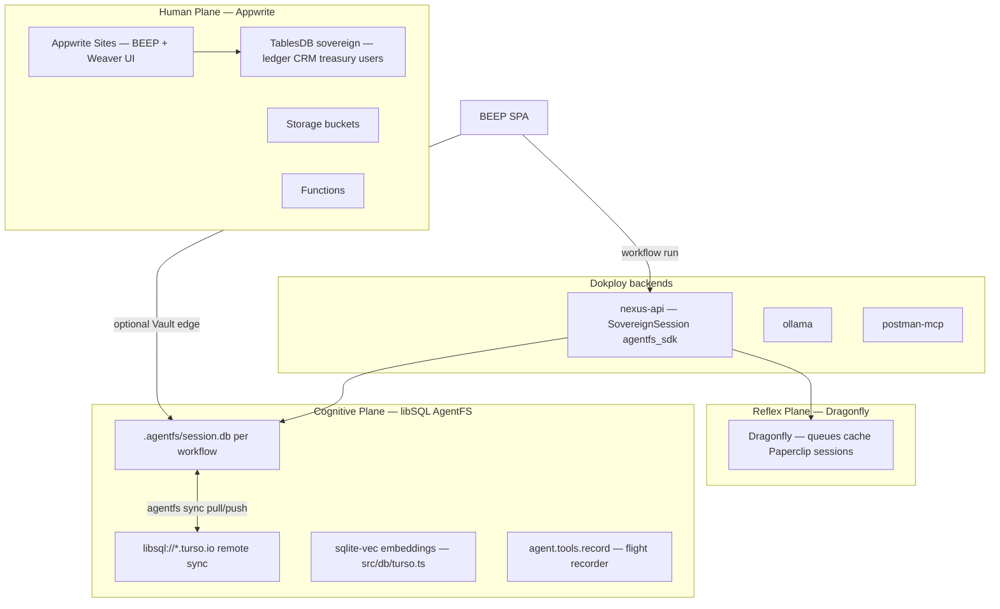
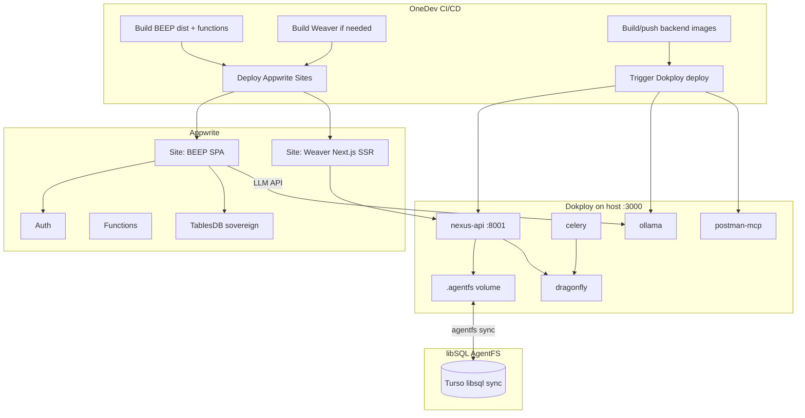
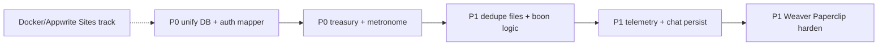

# BEEP + Weaver Docker Integration (revised)

## What changed (user decisions)

| Dropped | Kept / new |
|---------|------------|
| Dokploy one-click template | **Dokploy** runs backend containers |
| Git Compose as primary deploy path | **OneDev** CI/CD triggers builds + deploys |
| BEEP frontend in nginx Docker container | **Appwrite Sites** hosts BEEP (and Weaver) UI |
| Sovereign Appwrite stack as Phase 1 blocker | Defer full self-hosted Appwrite; use Appwrite Cloud/Sites first |

**Deploy split:** Appwrite = frontends + BaaS (auth, TablesDB, functions). Dokploy = long-running backend processes (Nexus, Ollama, MCP, Dragonfly, Celery). **libSQL/AgentFS** = cognitive plane (sandbox, audit, vectors) — not optional per FRS/EVOLUTION/frontend.md.

---

## Persistence Trinity (Appwrite + Dragonfly + libSQL/AgentFS)

Canonical ops reference: [`ide/llms-full.txt`](ide/llms-full.txt) (Turso AgentFS docs — auditing, overlay CoW, sync, MCP server).



| Plane | Technology | Owns | Already in repo |
|-------|------------|------|-----------------|
| **Ledger** | Appwrite TablesDB | Users, CRM, treasury rows, workflows metadata | beep `appwriteClient.ts` (partially wired) |
| **Reflex** | Dragonfly/Redis | Celery broker, hot orchestration state | ide `docker-compose.trinity.yml` |
| **Cognitive** | libSQL + AgentFS | CoW sandboxes, tool audit timeline, KV plans, vectors | ide `nexus/engine/swarm.py`, `src/db/turso.ts`, `src/services/agentfs.ts` |

**Rule:** Agent tool calls, file deltas, and execution forensics go to **AgentFS** (`scribe_tribute` / `agent.tools.record`). Human-visible canonical state goes to **Appwrite**. Ephemeral hot state goes to **Dragonfly**.

### What exists today (ide — use this, don't reinvent)

| Component | Path | Status |
|-----------|------|--------|
| AgentFS SDK sessions | [`nexus/engine/swarm.py`](ide/nexus/engine/swarm.py) `SovereignSession` | Working — KV, fs, tools.record |
| HTTP API | [`nexus/controllers/agentfs.py`](ide/nexus/controllers/agentfs.py) | `/api/v1/agentfs/*` mounted |
| Frontend client | [`src/services/agentfs.ts`](ide/src/services/agentfs.ts) | Full CRUD + sync |
| Canvas UI | [`src/components/canvas/agentfs-sandbox-bar.tsx`](ide/src/components/canvas/agentfs-sandbox-bar.tsx), [`use-agentfs-session.ts`](ide/src/hooks/use-agentfs-session.ts) | Wired on Weaver canvas |
| libSQL vectors/CDC | [`src/db/turso.ts`](ide/src/db/turso.ts), [`ai-memory.ts`](ide/src/services/ai-memory.ts), [`code-indexer.ts`](ide/src/services/code-indexer.ts) | `@libsql/client` |
| Orchestrator hook | [`nexus/engine/orchestrator.py`](ide/nexus/engine/orchestrator.py) | Opens SovereignSession per deliberation |
| Demiurge tools | [`nexus/tools/demiurge/write_code.py`](ide/nexus/tools/demiurge/write_code.py) | Writes into AgentFS sandbox |
| Env catalog | [`config/env.manifest.json`](ide/config/env.manifest.json) | `TURSO_*`, `AGENTFS_ROOT` |
| Readiness probe | [`nexus/controllers/readiness.py`](ide/nexus/controllers/readiness.py) | Checks `.agentfs/` + CLI |

### Gaps (must close)

| Gap | Where | Fix |
|-----|-------|-----|
| BEEP never calls AgentFS | beep has `@tursodatabase/database` in package.json, **zero TS usage** | Wire executor → Nexus `/agentfs/session/{id}/init` + timeline POST via `scribe_tribute` proxy |
| BEEP Vault is mock UI | [`modules/vault/VaultView.tsx`](beep/modules/vault/VaultView.tsx) | libSQL edge file (`file:beep-vault.db`) or Nexus AgentFS session |
| CRM CoW not implemented | [`CRM.md`](beep/CRM.md) spec | CRM mutations → AgentFS overlay; commit to Appwrite on human approve |
| Telemetry audit P1 wrong target | Plan said Appwrite-only | **Primary:** AgentFS timeline; **Secondary:** mirror summary rows to Appwrite `agent_executions` |
| bedrock-slice empty | [`src/store/slices/bedrock-slice.ts`](ide/src/store/slices/bedrock-slice.ts) | Load from Turso via existing `turso` client |
| Turso sync not in Docker | Nexus controller shells `agentfs` CLI | Install `agentfs` binary in [`nexus/Dockerfile.release`](ide/nexus/Dockerfile.release); mount `AGENTFS_ROOT` volume in cradle-compose |
| Strategy panel placeholder | [`strategy-panel.tsx`](ide/src/components/panels/strategy-panel.tsx) L51 | Scry real AgentFS KV (`core:procedural:active_plan`) |
| Weaver graph canonical store | [`frontend.md`](beep/frontend.md) | Persist workflow graph snapshot to AgentFS KV on save (Architect mode) |

### AgentFS ops (from llms-full.txt)

**Local dev (weave):**
```bash
# Per workflow session — Nexus API handles via SDK; CLI for debug:
agentfs timeline my-session --format json
agentfs diff my-session
agentfs fs ls my-session
tursodb .agentfs/my-session.db   # SQL audit queries
```

**Turso cloud sync (Dokploy prod):**
```bash
turso db create cradle-agentfs
turso db show cradle-agentfs --url   # libsql://...
agentfs init sovereign-core --sync-remote-url libsql://...
agentfs sync sovereign-core push|pull|checkpoint
```

**MCP exposure (optional):**
```bash
agentfs serve mcp my-agent --tools read_file,write_file,kv_get,kv_set
```
BEEP postman-mcp can coexist; AgentFS MCP is for filesystem/KV tools per Turso docs.

### BEEP → Nexus AgentFS integration (new)

1. Add [`beep/services/agentfsBridge.ts`](beep/services/agentfsBridge.ts) — thin client to `VITE_NEXUS_URL/api/v1/agentfs/*` (same contract as ide `agentfsService`)
2. [`useWorkflowExecutor.ts`](beep/hooks/useWorkflowExecutor.ts): on run start → `initSession(workflowId)`; each agent step → `POST` tribute via Nexus; on complete → expose timeline in Glasshouse/Simulacrum
3. [`useStreamingChat.ts`](beep/hooks/useStreamingChat.ts): session id = `chat-{userId}`; persist turns as `agent.tools.record` entries (not empty TODO)
4. [`modules/weaver/Weaver.tsx`](beep/modules/weaver/Weaver.tsx): bind `useWorkflowState` save to AgentFS KV `weaver:graph:{id}`

### Docker / Dokploy requirements for AgentFS

Add to [`ide/compose/cradle.yml`](ide/compose/cradle.yml):

```yaml
services:
  nexus-api:
    environment:
      AGENTFS_ROOT: /data/agentfs
      TURSO_DATABASE_URL: ${TURSO_DATABASE_URL}
      TURSO_AUTH_TOKEN: ${TURSO_AUTH_TOKEN}
    volumes:
      - agentfs_data:/data/agentfs

volumes:
  agentfs_data:   # named volume — Dokploy Volume Backups eligible
```

- Install `agentfs` CLI in Nexus Docker image for sync/diff endpoints
- **Do not** containerize libSQL sqld separately — AgentFS SDK + embedded `.db` files per session ([EVOLUTION.md](beep/EVOLUTION.md) §6.1)
- BEEP frontend (Appwrite Sites) does **not** mount AgentFS directly — always via Nexus API

### Context7 lookup at execution

Resolve Turso/AgentFS library IDs before implementing BEEP bridge; cross-check with [`llms-full.txt`](ide/llms-full.txt) for sync/overlay semantics.

---

## Docker vs Podman (plain English)

Think of both as **box shippers** for your app:

- **Image** = frozen recipe (filesystem + startup command)
- **Container** = a running instance of that recipe
- **Compose file** = list of which recipes run together, on which ports, with which env vars

**Docker** is the common default; **Dokploy requires Docker** today ([no native Podman](https://github.com/Dokploy/dokploy/issues/134)).

**Podman** is a drop-in alternative: same `docker-compose.yml` syntax, rootless by default (more secure). You can later run `podman compose up` on the same files, but **keep Docker for Dokploy** until Podman support lands.

**Plan:** write **OCI-standard compose files** (no Docker-only hacks). Document optional `podman compose` for local dev in [`docs/containers.md`](docs/containers.md). Do not block on Podman.

---

## Architecture



### Port map (Dokploy owns :3000)

| Service | Host port | Where |
|---------|-----------|-------|
| Dokploy UI | 3000 | reserved |
| Nexus API | 8001 | Dokploy |
| Ollama | 11434 | Dokploy |
| Postman MCP | 3100 | Dokploy |
| Dragonfly | 6379 | Dokploy |
| BEEP UI | — | Appwrite Sites URL |
| Weaver UI | — | Appwrite Sites URL |

---

## BEEP: Appwrite Sites (frontend) + Docker (aux only)

**Today:** Vite dev on `:3000`, no deploy pipeline ([`beep/index.tsx`](beep/index.tsx) uses `HashRouter` — ideal for static Sites).

**Target:**

1. **Appwrite Site** — static SPA
   - Install: `bun install`
   - Build: `bun run build`
   - Output: `./dist`
   - Env at build: `VITE_APPWRITE_*`, `VITE_NEXUS_URL`, `VITE_OLLAMA_URL` (public URLs to Dokploy services, **not** Vite dev proxies)

2. **Remove** prod nginx frontend container from BEEP compose (no `beep-frontend` image for UI)

3. **Docker services remain** (Dokploy):
   - `ollama` — LLM
   - `postman-mcp` — MCP bridge ([`backend/postman-mcp-server.ts`](beep/backend/postman-mcp-server.ts) — fix `allowedHosts` + `/health`)

4. **Appwrite config** — add to [`beep/appwrite.json`](beep/appwrite.json):
   ```json
   "sites": [{ "siteId": "beep", "name": "BEEP Command", ... }]
   ```
   Plus deploy script: `appwrite deploy site` or OneDev step calling Appwrite CLI.

5. **Dev proxies gap:** [`beep/vite.config.ts`](beep/vite.config.ts) `/ollama` and `/mcp` proxies exist only in dev. Production uses env vars pointing at Dokploy public endpoints (or Appwrite Function proxy later).

**Key files to create/change (BEEP repo):**

| File | Action |
|------|--------|
| [`beep/docker-compose.yml`](beep/docker-compose.yml) | **New** — `ollama`, `postman-mcp` only (+ dev profile optional) |
| [`beep/Dockerfile.mcp`](beep/Dockerfile.mcp) | **New** — Bun MCP image |
| [`beep/docker/ollama/entrypoint.sh`](beep/docker/ollama/entrypoint.sh) | **New** — GGUF model registration |
| ~~`Dockerfile` nginx prod~~ | **Removed** from scope |
| [`beep/appwrite.json`](beep/appwrite.json) | Add `sites` block |
| [`beep/.onedev-buildspec.yml`](beep/.onedev-buildspec.yml) | **New** — build site + deploy functions + push MCP/Ollama tags |
| [`beep/docs/deploy.md`](beep/docs/deploy.md) | OneDev + Appwrite Sites + Dokploy flow |

---

## Weaver IDE: Appwrite Sites (frontend) + existing Docker backend

**Today:** [`ide/docker-compose.deploy.yml`](ide/docker-compose.deploy.yml) runs GHCR images (frontend, nexus-api, celery, dragonfly). [`ide/Dockerfile`](ide/Dockerfile) builds Next standalone. [`ide/next.config.ts`](ide/next.config.ts) rewrites `/api/v1` → `localhost:8001` — **broken in split deploy**.

**Target:**

1. **Weaver UI → Appwrite Sites (SSR)**
   - Framework: Next.js
   - Build: `bun run build` (may need `output: 'standalone'` → SSR mode on Sites per [Appwrite Sites SSR docs](https://appwrite.io/docs/products/sites/rendering/ssr))
   - Runtime env: `NEXT_PUBLIC_NEXUS_URL=https://nexus.yourdomain.com` (Dokploy-routed Nexus)

2. **Fix [`ide/next.config.ts`](ide/next.config.ts)** — rewrite target from hardcoded `localhost:8001` to `process.env.NEXUS_INTERNAL_URL || process.env.NEXT_PUBLIC_NEXUS_URL`

3. **Dokploy compose** — drop `frontend` service from deploy compose; keep:
   - `nexus-api`, `celery`, `dragonfly` ([existing `docker-compose.deploy.yml`](ide/docker-compose.deploy.yml))

4. **Unified stack option** — [`ide/compose/cradle.yml`](ide/compose/cradle.yml) (from [unification plan](ide/.cursor/plans/λξvos_beep_weaver_unification_ac064d66.plan.md)):
   - Includes Weaver backend + BEEP aux (ollama, mcp) on one `cradle-network`
   - Used by Dokploy as single Compose project

**Key files (IDE repo):**

| File | Action |
|------|--------|
| [`ide/compose/cradle.yml`](ide/compose/cradle.yml) | **New** — merged backend stack |
| [`ide/compose/cradle.deps.yml`](ide/compose/cradle.deps.yml) | **New** — include BEEP ollama/mcp via relative path or copied services |
| [`ide/.onedev-buildspec.yml`](ide/.onedev-buildspec.yml) | **New** — replace/supplement GitHub Actions CD for your OneDev host |
| [`ide/next.config.ts`](ide/next.config.ts) | Env-driven Nexus rewrite |
| [`ide/docs/deploy.md`](ide/docs/deploy.md) | Dokploy + Appwrite Sites split |

---

## OneDev CI/CD (replaces Git Compose deploy)

No `.onedev-buildspec.yml` exists in either repo today. OneDev runs jobs from [`.onedev-buildspec.yml`](https://docs.onedev.io/tutorials/cicd/understanding-pipeline) (UI editor or YAML).

### BEEP pipeline (`.onedev-buildspec.yml`)

```yaml
# Conceptual jobs
jobs:
  - name: test
    steps: [checkout, bun install, bun test, bun run typecheck]
  - name: build-site
    steps: [bun run build, publish dist/ artifact]
  - name: deploy-site
    dependencies: [build-site]
    steps: [appwrite deploy site --activate]
  - name: deploy-functions
    steps: [bash scripts/deploy-appwrite-functions.sh]
  - name: build-backend-images
    steps: [docker build Dockerfile.mcp, docker push]
  - name: deploy-dokploy
    dependencies: [build-backend-images]
    steps: [curl Dokploy webhook or compose.deploy API]
```

### Weaver pipeline

```yaml
jobs:
  - name: test
    steps: [bun install, bun run build, pytest nexus]
  - name: deploy-weaver-site
    steps: [appwrite deploy site for ide repo]
  - name: build-nexus-images
    steps: [docker build nexus/Dockerfile.release, push GHCR/local registry]
  - name: deploy-dokploy
    steps: [trigger Dokploy with WEAVER_IMAGE_TAG]
```

**OneDev needs Docker socket** (`/var/run/docker.sock`) for image builds. Repos live in OneDev Git (mirror from GitHub if needed).

**Dokploy trigger:** use Dokploy [Compose API](https://docs.dokploy.com/docs/api/compose) webhook or redeploy endpoint after images push — not manual compose git pull.

---

## Dokploy setup (simplified)

1. Create project **`cradle-backend`**
2. Compose source: Git (OneDev remote) OR raw compose from repo
3. Compose file: `ide/compose/cradle.yml` (Weaver backend + BEEP ollama/mcp)
4. Env: paste from `.env.dokploy.example` (no frontend ports except Nexus/Ollama/MCP)
5. Domains in Dokploy UI:
   - `nexus.yourdomain.com` → `nexus-api:8001`
   - (Ollama/MCP: internal or subdomain with auth — do not expose raw Ollama publicly without gate)

**Removed from scope:** `dokploy/blueprints/`, base64 template import, `docker-compose.sovereign.yml` (Phase 2 if needed).

---

## MCP usage (unchanged mandate)

| Phase | MCP |
|-------|-----|
| Preflight | Context7 (Docker Compose, Appwrite Sites, OneDev), Appwrite docs+API, Notion, PostHog |
| BEEP Sites | Appwrite MCP — Sites config, deploy-from-git, static SPA fallback |
| Backend deploy | Browser MCP smoke Nexus/Ollama health URLs |
| Post-deploy | PostHog error scan, Notion task updates |

---

## Implementation order

1. **Docs primer** — `docs/containers.md` (Docker/Podman explained), update `AGENTS.md`
2. **BEEP** — slim `docker-compose.yml` (ollama + mcp), `Dockerfile.mcp`, ollama entrypoint, MCP health fix
3. **BEEP** — Appwrite Sites config in `appwrite.json`, build env vars, remove reliance on Vite prod proxy
4. **Weaver** — fix `next.config.ts` Nexus URL; trim `docker-compose.deploy.yml` (no frontend container)
5. **ide/compose/cradle.yml** — merged backend + `agentfs_data` volume + Turso env
6. **AgentFS wire-up** — BEEP executor/chat → Nexus AgentFS; Vault libsql; bedrock-slice Turso load
7. **OneDev** — `.onedev-buildspec.yml` in both repos
8. **Dokploy** — `docs/dokploy.md` + `.env.dokploy.example`
9. **MCP verify** — Browser + PostHog + `agentfs timeline` smoke

---

## Verification checklist

- [ ] `bun run build` in BEEP produces `dist/` deployable to Appwrite Sites
- [ ] Appwrite Site serves BEEP login + dashboard (HashRouter routes work)
- [ ] Dokploy runs ollama + mcp + nexus-api + dragonfly + celery without frontend containers
- [ ] Weaver Site reaches Nexus at public/env URL (not localhost)
- [ ] OneDev pipeline: commit → site redeploy + backend image update
- [ ] Dokploy UI still on `:3000`
- [ ] AgentFS session created on workflow run; timeline visible via `agentfs timeline` or Weaver UI
- [ ] Turso sync push/pull works from Dokploy Nexus container
- [ ] BEEP Vault or CRM sandbox uses libSQL/AgentFS CoW (not mock data)

---

## Codebase Audit (2026-06-19)

Comprehensive line-by-line and cross-module audit of **beep** + **ide** (Weaver). Linked spec: [Implementation Plan: BEEP DOP](https://app.notion.com/p/38468e0e54a8813ab4e7e7e3cdc3bf44). Remediation tasks: `AUDIT-T*` (create in Notion on execute).

### Severity summary

| Severity | BEEP | IDE | Cross-repo |
|----------|------|-----|------------|
| **P0** | 8 | 8 | DB ID split (`sovereign` vs `levon_nexus`) |
| **P1** | 18+ | 18+ | Duplicated Appwrite clients + setup scripts |
| **P2** | 10+ | 10+ | Dead files, demo mocks, test debt |

### P0 — Must fix before production

#### Cross-repo: split brain on Appwrite

| Repo | Database ID | Setup script |
|------|-------------|--------------|
| beep | `sovereign` ([`services/appwriteClient.ts`](beep/services/appwriteClient.ts)) | [`scripts/setup-appwrite-backend.ts`](beep/scripts/setup-appwrite-backend.ts) (~40 tables) |
| ide | `levon_nexus` ([`src/services/realtime.ts`](ide/src/services/realtime.ts), [`scripts/setup-appwrite.ts`](ide/scripts/setup-appwrite.ts)) | 2 tables only (`blueprints`, `agents`) |

**Fix:** Canonical ID = `sovereign`. Merge setup scripts. ide browser client must migrate **Databases → TablesDB** (beep already uses TablesDB).

#### BEEP — economy/treasury entirely mocked

| File | Issue |
|------|-------|
| [`services/xiEconomyService.ts`](beep/services/xiEconomyService.ts) | Returns hardcoded numbers; never reads `treasury_transactions` / `ledger` |
| [`hooks/useTreasuryState.ts`](beep/hooks/useTreasuryState.ts) | Real Appwrite hook — **zero imports** |
| [`services/backendFunctionService.ts`](beep/services/backendFunctionService.ts) | `performTreasuryOperation()` — **zero call sites** |
| [`services/klepsydraService.ts`](beep/services/klepsydraService.ts) | `Math.random()` outcomes; `console.log` only |
| [`services/ritesService.ts`](beep/services/ritesService.ts) | Static defaults; all Appwrite TODOs |
| [`hooks/useWorkflowExecutor.ts`](beep/hooks/useWorkflowExecutor.ts) | `manifestBoon` updates local balance without ledger |

**DRY target:** `services/treasuryService.ts` + `services/metronomeService.ts` (rites + klepsydra + boon).

#### BEEP — auth profile shape bug

[`contexts/AuthContext.tsx`](beep/contexts/AuthContext.tsx) spreads raw Appwrite row (`xi_balance`) onto `CurrentUser` expecting camelCase (`xiBalance`). `hasOnboarded` hardcoded `false`.

**Fix:** `services/userProfileService.ts` with single `mapUserRowToCurrentUser()`.

#### BEEP — no agent/chat telemetry

Zero Appwrite writes for `agent_executions`. **Fix:** AgentFS `scribe_tribute` via Nexus (primary); optional Appwrite mirror for dashboard queries.

#### BEEP — libsql dependency unused

[`package.json`](beep/package.json) has `@tursodatabase/database` but no imports. Use for Vault edge or remove in favor of Nexus-only AgentFS bridge.

#### BEEP — server execution disconnected

[`backend/functions/process-workflow.ts`](beep/backend/functions/process-workflow.ts) defaults `WORKFLOW_EXECUTOR_MODE=stub`. Client runs Ollama in-browser; server path never called.

#### IDE — Docker/deploy broken by localhost rewrites

[`next.config.ts`](ide/next.config.ts) hardcodes `http://localhost:8001` — fails inside containers and Appwrite Sites split deploy.

#### IDE — Paperclip not production-safe

[`nexus/services/paperclip_bridge.py`](ide/nexus/services/paperclip_bridge.py): in-memory sessions (lost on restart); webhook auth bypass when `PAPERCLIP_WEBHOOK_SECRET` unset.

### P1 — Incomplete features / duplication

#### BEEP duplicate files (delete or merge)

| Dead duplicate | Keep |
|----------------|------|
| [`components/economy/XiDashboard.tsx`](beep/components/economy/XiDashboard.tsx) | [`modules/economy/XiDashboard.tsx`](beep/modules/economy/XiDashboard.tsx) |
| [`modules/admin/AccessKeysPanel.tsx`](beep/modules/admin/AccessKeysPanel.tsx) | [`components/admin/AccessKeysPanel.tsx`](beep/components/admin/AccessKeysPanel.tsx) + wire `TABLES.ACCESS_KEYS` |
| [`modules/admin/IntegrationsPanel.tsx`](beep/modules/admin/IntegrationsPanel.tsx) | [`components/admin/IntegrationsPanel.tsx`](beep/components/admin/IntegrationsPanel.tsx) (Appwrite version) |

#### BEEP triplicated boon/economy logic

- [`hooks/useWorkflowExecutor.ts`](beep/hooks/useWorkflowExecutor.ts) `manifestBoon`
- [`modules/economy/XiDashboard.tsx`](beep/modules/economy/XiDashboard.tsx) tribute path
- [`hooks/useKlepsydra.ts`](beep/hooks/useKlepsydra.ts) Xi mint

→ Consolidate to `metronomeService.applyOutcome()`.

#### BEEP stub services (wire or delete)

| File | Status |
|------|--------|
| [`services/weaverService.ts`](beep/services/weaverService.ts) | Unused; Weaver uses `useWorkflowState` |
| [`services/beepService.ts`](beep/services/beepService.ts) | Dead code |
| [`services/loomService.ts`](beep/services/loomService.ts), [`switchboardService.ts`](beep/services/switchboardService.ts) | `export const mock = {}` |
| [`services/aegisService.ts`](beep/services/aegisService.ts) | Random health scores |
| [`services/widgetService.ts`](beep/services/widgetService.ts) | Hardcoded widget data |

#### BEEP module UIs with embedded mocks (spec surfaces)

[`VaultView`](beep/modules/vault/VaultView.tsx), [`RegistryView`](beep/modules/registry/RegistryView.tsx), [`ThePantheon`](beep/components/admin/ThePantheon.tsx), [`DemiurgeConsole`](beep/components/admin/DemiurgeConsole.tsx) — UI without backend writes.

#### IDE Appwrite client duplication (3 wrappers)

- [`src/services/appwrite.ts`](ide/src/services/appwrite.ts) — legacy Databases
- [`src/services/appwrite-server.ts`](ide/src/services/appwrite-server.ts)
- [`src/db/db.ts`](ide/src/db/db.ts)
- [`nexus/services/appwrite_service.py`](ide/nexus/services/appwrite_service.py)

**DRY target:** shared `@lazvos/appwrite-client` package (or beep exports from `appwriteClient.ts`).

#### IDE other P1 gaps

- [`src/store/slices/bedrock-slice.ts`](ide/src/store/slices/bedrock-slice.ts) — never loads rows
- [`src/services/realtime.ts`](ide/src/services/realtime.ts) — legacy `Channel.collection()` format
- No port of [`beep/services/authErrors.ts`](beep/services/authErrors.ts) to ide login
- Stripe mock default in beep ([`stripeService.ts`](beep/services/stripeService.ts) unless `VITE_USE_MOCK_STRIPE=false`)

### P2 — Demo mocks, dead code, test debt

Marketing/finance demo mocks (`PersonaLab`, `SocialPulse`, `CapTable`, `HRMView` TEAM roster). ide `Purged` migration files. ~90 Nexus unit tests still patch `superagi.*`. [`backend/llm-server.ts`](beep/backend/llm-server.ts) non-functional skeleton.

### Spec ↔ code gap matrix

| Doc requirement | Expected | Actual |
|-----------------|----------|--------|
| BUILD_PLAN Phase 2.5–2.6 treasury/rites/klepsydra | Appwrite-backed | All stubbed |
| BUILD_PLAN Phase 2.7–2.8 agent/chat logging | DB tables used | Zero code refs |
| economy.md CEVM + IQI | Live `agent_metrics` | Slider demo only ([`CEVMCalculator.tsx`](beep/components/economy/CEVMCalculator.tsx)) |
| FRS Glasshouse / narrative observability | Execution log gossip | Hardcoded HUD in [`SimulacrumView`](beep/modules/simulacrum/SimulacrumView.tsx) |
| frontend.md Sovereign's Halo tribute velocity | Real Ξ data | Mocked via `xiEconomyService` |
| CRM (BUILD_PLAN §3.1) | Mock | **Actually wired** — plan doc stale |

### What's actually working (don't break)

- beep: [`appwriteClient.ts`](beep/services/appwriteClient.ts), [`crmService.ts`](beep/services/crmService.ts), [`useWorkflowState.ts`](beep/hooks/useWorkflowState.ts), [`useOperationsState.ts`](beep/hooks/useOperationsState.ts), [`ollamaService.ts`](beep/services/ollamaService.ts)
- ide: Paperclip bridge parsing, BEEP guardrails tests, [`docker-compose.deploy.yml`](ide/docker-compose.deploy.yml) backend images, [`weave`](ide/weave) host-dev path

### Audit remediation phases (runs parallel to Docker work)



**Phase A (P0):** Unify database + userProfileService + treasuryService + metronomeService  
**Phase B (P1):** Delete duplicates; AgentFS telemetry + chat via Nexus; bedrock-slice Turso load  
**Phase C (P1):** ide next.config env rewrites, Paperclip Redis sessions, bedrock rows, HTTP tests  
**Phase D (P2):** Remove dead services, update stale BUILD_PLAN.md, port authErrors to ide

### DRY consolidation registry

| Pattern | Locations | Single owner |
|---------|-----------|--------------|
| Appwrite bootstrap | beep `appwriteClient.ts`, ide `appwrite.ts` + server + db | `@lazvos/appwrite-client` |
| Schema provisioning | beep `setup-appwrite-backend.ts`, ide `setup-appwrite.ts` | `scripts/setup-appwrite-unified.ts` |
| Boon/tribute | executor, XiDashboard, useKlepsydra | `metronomeService.applyOutcome()` |
| Xi balance update | AuthContext, executor, klepsydra | `treasuryService.debit/credit()` |
| Auth errors | beep only | shared `authErrors.ts` |
| Workflow execution | beep client Ollama vs Appwrite fn vs Nexus | Nexus + AgentFS session owns server path; client Ollama logs to AgentFS timeline |
| Agent audit / IQI | Appwrite tables only (planned) | AgentFS timeline (primary) + Appwrite summary mirror |
| libSQL clients | ide `@libsql/client`, beep `@tursodatabase/database` unused | BEEP → Nexus API; ide keeps `src/db/turso.ts` for vectors |

---

## Notion Command Board (configured)

**Primary board:** [ΛΞVOS Tasks — Code with Notion](https://app.notion.com/p/cee68e0e54a8836aa9e081274865eb1c?v=3b168e0e54a8830bb5be084b026bca31)

**Hub page:** [ΛΞVOS Cradle — Command Board](https://app.notion.com/p/38468e0e54a88111ba91f56d839f8f55) 🏛️

**Populated:** 2026-06-19 — 1 hub + 17 tasks (DOCKER×7, AFS×3, AUDIT-P0×3, AUDIT-P1×3, VERIFY×1)

| Item | Value |
|------|-------|
| Database ID | `cee68e0e-54a8-8362-829e-8105ba72cc4b` |
| Data source | `collection://1b668e0e-54a8-82ba-a1a5-073e98060e0b` |
| Default view | **All Tasks** (table) |
| Kanban view | **By Status** (board) |
| Template | New task (`c2468e0e-54a8-8362-829e-8105ba72cc4b`) |

**Schema (agent-ready — no changes needed):**

| Property | Use |
|----------|-----|
| Task name | Title |
| Status | Not started → Planning → Ready → In progress → Done |
| Assignee | Human owner |
| Due date | Sprint target |
| Agent blocked | Checkbox when MCP/deploy blocked |
| Agent status | Free text — Cursor agent progress notes |

### Pretty setup (on populate)

**1. Hub page** (standalone, linked from board description):
- Title: **ΛΞVOS Cradle — Command Board**
- Icon: 🏛️
- Sections: Deploy stack · AgentFS/libSQL · Code audit · Links

**2. Task naming & icons**

| Phase | Prefix | Status | Due |
|-------|--------|--------|-----|
| 🚀 Deploy & Docker | `DOCKER-T*` | Ready → In progress | Week 1 |
| 🧠 AgentFS / libSQL | `AFS-T*` | Ready | Week 1–2 |
| 🔴 Audit P0 | `AUDIT-P0-*` | Ready | ASAP |
| 🟡 Audit P1 | `AUDIT-P1-*` | Planning | Week 2 |
| ✅ Verify | `VERIFY-T*` | Planning | After deploy |

**3. Task manifest (17 tasks from plan)**

Deploy (`DOCKER-T01`–`T07`):
- T01 Container docs + AGENTS.md
- T02 BEEP compose (ollama + MCP)
- T03 Appwrite Sites for BEEP
- T04 Weaver Nexus rewrite + deploy compose trim
- T05 cradle.yml + AgentFS volume
- T06 OneDev pipelines (beep + ide)
- T07 Dokploy backend docs + env

AgentFS (`AFS-T01`–`T03`):
- T01 Wire BEEP executor/chat → Nexus AgentFS
- T02 Vault libsql + CRM CoW overlay
- T03 Turso sync + bedrock-slice + agentfs CLI in image

Audit P0 (`AUDIT-P0-01`–`03`):
- 01 Unify sovereign DB + auth mapper
- 02 Treasury service (replace mocks)
- 03 Metronome service (rites + klepsydra)

Audit P1 (`AUDIT-P1-01`–`03`):
- 01 Delete duplicate files + boon consolidation
- 02 AgentFS telemetry + chat timeline
- 03 Paperclip harden + bedrock + HTTP tests

Verify (`VERIFY-T01`):
- MCP preflight + Appwrite Sites + Browser + PostHog smoke

Each task page includes: **Files**, **Acceptance criteria**, link to [BEEP DOP plan](https://app.notion.com/p/38468e0e54a8813ab4e7e7e3cdc3bf44) + local plan path.

**4. Manual polish (optional in Notion UI)**
- Rename database title to **ΛΞVOS Command Board**
- Add cover: dark teal / verdigris gradient
- Pin **By Status** board as favorite tab
- Move board under [PRIME DIRECTIVE START](https://app.notion.com/p/24c68e0e54a880c2ad58da8ade941d0b)

**Legacy board:** [Old GTD Tasks](https://app.notion.com/p/1cf68e0e54a8816aa937d4c675c08e2f) — archive after migration.

**Populate:** Done — use **By Status** kanban for daily flow.

---

## Out of scope (this iteration)

- Dokploy marketplace template
- Full self-hosted Appwrite sovereign stack
- Podman as Dokploy runtime
- GitHub Actions removal (can coexist until OneDev proven)
- Full P2 demo mock removal (marketing modules) — track separately
